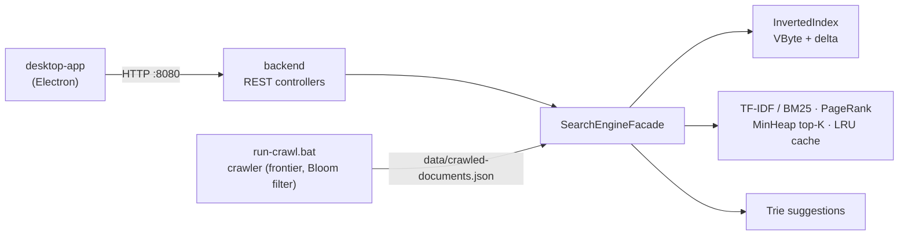

# CocCoc-Plus — a Vietnamese search engine built on hand-written DSA

A small Vietnamese search engine: a crawler, an inverted index, ranking, and a
mini browser to query it. Two parts only:

- **`backend/`** — one Spring Boot process (monolith) on port **8080**.
- **`desktop-app/`** — the browser (Electron + React + TypeScript).

Every core data structure and algorithm is **hand-written**, with no
off-the-shelf search library. Spring is only used to expose them over REST.

| Data structure / algorithm | Where | Used for |
|---|---|---|
| Inverted index + VByte/delta compression | `index/InvertedIndex`, `CompressedPostings`, `VByteCodec` | Term → posting list |
| Vietnamese word segmenter (max-weight) | `index/MaxWeightSegmenter`, `VietnameseTokenizer` | Tokenizing queries and documents |
| Trie / SyllableTrie | `datastructure/Trie`, `SyllableTrie` | Prefix suggestions, dictionary lookup |
| Bloom filter | `datastructure/BloomFilter` | "URL already seen?" in the crawler |
| MinHeap | `datastructure/MinHeap` | Top-K results |
| LRU cache | `datastructure/LRUCache` | Query result cache |
| Sparse matrix + PageRank | `datastructure/SparseMatrix`, `ranking/PageRankService` | Link-based ranking |
| TF-IDF, BM25 (+ decorators) | `ranking/` | Relevance scoring |
| Query parser (AST: AND / OR / NOT / phrase) | `query/` | Boolean and phrase queries |
| Posting-list merge | `query/PostingListMerger` | Intersect / union / difference |
| Two-tier URL frontier | `crawler/frontier/` | Politeness and priority in the crawler |
| robots.txt parser, URL canonicalizer | `crawler/` | Crawling rules |

All paths are under `backend/src/main/java/com/vnsearch/`.



---

## Quick start

Requires JDK 17+ and Node.js 22+.

```bash
run-backend.bat      # builds the jar on first run, then serves http://localhost:8080
run-frontend.bat     # in a second window: installs npm packages and opens the browser
```

Or by hand:

```bash
cd backend
./mvnw -B clean package -DskipTests
java -jar target/vnsearch-0.0.1-SNAPSHOT.jar     # run from backend/ — data paths are relative

cd desktop-app
npm install
npm run dev
```

```bash
curl "http://localhost:8080/api/health"
curl "http://localhost:8080/api/search?q=máy+tính&size=3"
```

`run-backend.bat` flags: `--build` (rebuild the jar), `--reindex` (delete
`data/index.json` so the index is rebuilt from the corpus). `end-backend.bat`
stops whatever is listening on port 8080.

Without a crawled corpus the backend falls back to `data/seed-documents.json`,
a small sample committed to the repo, so search works right after cloning.

### Crawling your own corpus

```bash
run-crawl.bat                                 # 10,000 pages, depth 4
run-crawl.bat 5000 3                          # 5,000 pages, depth 3
run-crawl.bat 500 2 data/try.json --fresh     # wipe and restart; asks you to type XOA
```

Without `--fresh` a run **resumes** an existing corpus. When the crawl finishes
it deletes `data/index.json`; restart the backend to index the new corpus.

`crawl-stats.bat` reports what a corpus contains — pages, links, images, size.

---

## API

| Endpoint | Description |
|---|---|
| `GET /api/search?q=&page=&size=` | Search |
| `GET /api/suggest?prefix=&limit=` | Prefix suggestions (Trie). Note: `prefix`, **not** `q` |
| `GET /api/images?q=&page=&size=` | Image search |
| `GET /api/feed?seed=&page=&size=` | Browse the index without a query. Same `seed` ⇒ same order |
| `GET /api/health` | Liveness. Returns `503` when the index is empty |

Browsing history, search history, settings and bookmarks live in the browser's
`localStorage`; the backend has no accounts and stores nothing per user.

---

## Configuration

Set through environment variables (defaults in
`backend/src/main/resources/application.properties`):

| Variable | Default | Effect |
|---|---|---|
| `APP_RANKING_SCORER` | `tfidf` | `tfidf` or `bm25` |
| `SERVER_PORT` | `8080` | Backend port |
| `APP_CRAWLER_DATA_PATH` | `data/crawled-documents.json` | Corpus file |
| `APP_INDEX_PATH` | `data/index.json` | Saved index (rebuilt if missing) |
| `APP_SEARCH_CACHE` | `200` | LRU cache size |

---

## Development

```bash
cd backend && ./mvnw test                                        # ~520 JUnit tests
cd desktop-app && npm run typecheck && npm run lint && npm test  # Vitest
```

`RankingQualityTest` guards search quality: it fails if ranking on the seed
corpus gets worse, even when every other test stays green.

## Repository layout

```
backend/                     Single Maven module (Spring Boot)
  src/main/java/com/vnsearch/
    datastructure/           Trie, SyllableTrie, BloomFilter, MinHeap, LRUCache, SparseMatrix
    index/                   Inverted index, VByte compression, Vietnamese segmenter
    query/                   Query parser (AST), posting-list merging, filters
    ranking/                 TF-IDF, BM25, PageRank, decorators, snippets
    crawler/                 Downloader, robots.txt, URL frontier, Bloom-filter dedup
    storage/                 JSON document store
    eval/                    Search quality harness
    service/                 SearchEngineFacade — wires everything together
    controller/              REST endpoints
  data/                      Corpus, index, images
  tools/build_dict.py        Regenerates the Vietnamese dictionary
desktop-app/                 Mini browser (Electron + React + TypeScript)
docs/                        Report and documentation
```

The Vietnamese dictionary is generated from
[`coccoc-tokenizer`](https://github.com/coccoc/coccoc-tokenizer) (LGPL-3.0),
which is **not** vendored here — clone it separately if you need to regenerate
`vietnamese-words.txt`.
